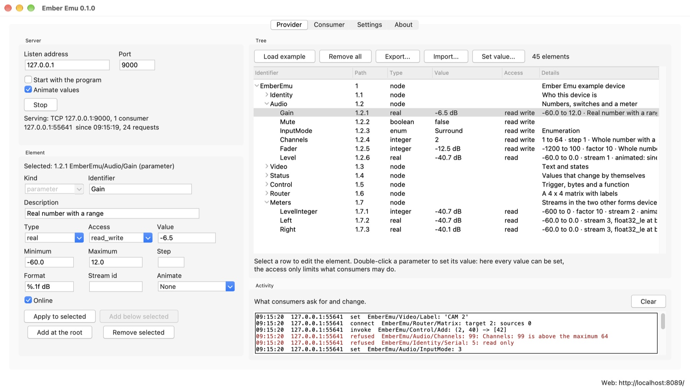
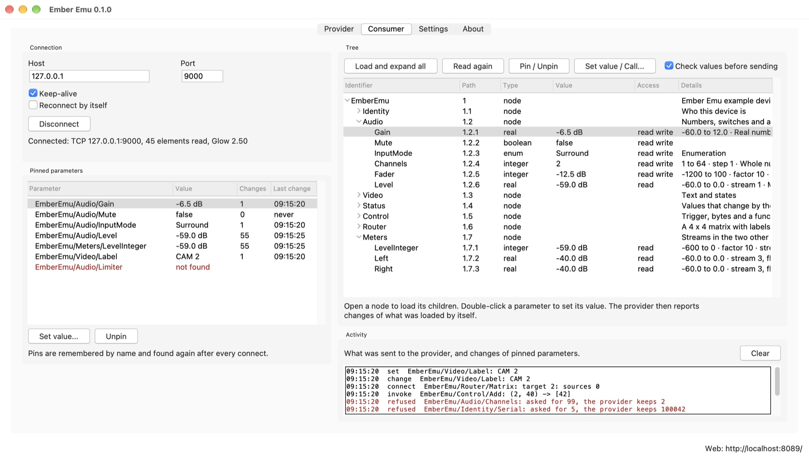
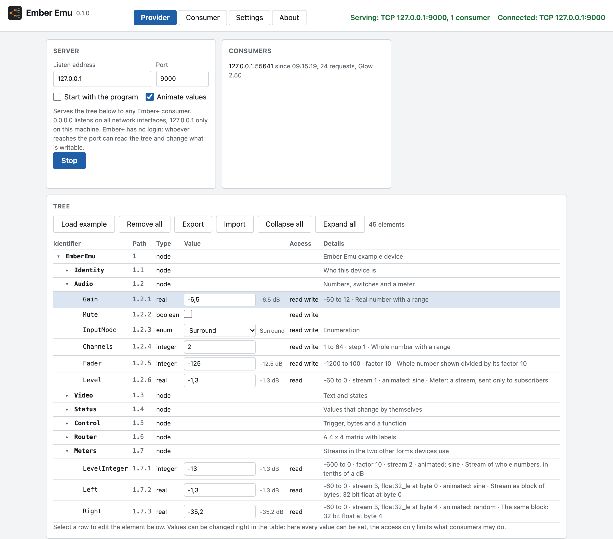
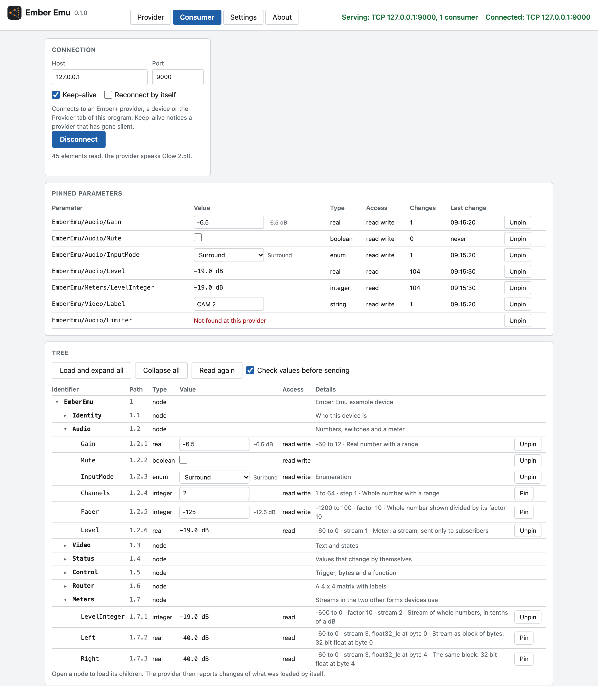

<p align="center">
  
</p>

# Ember Emu

Ember Emu is a test tool for Ember+, the protocol that control systems use to
read and set the parameters of broadcast devices. It plays both sides: it
serves a virtual device whose tree you put together yourself, and it reads the
tree of any real device and keeps the values you care about in view.

Use it to try a control system against a device that is not on your desk, to
see what a device really reports, or to find out how it reacts to values it
should refuse.

It runs on macOS, Windows and Linux. Ember Emu is the sibling of
[Tally Tapir](https://github.com/MarcusMa-dotcom/tally-tapir), which does the
same for TSL UMD tally packets.



## What it does

- **Provider:** a virtual Ember+ tree that any consumer on the network can
  read. Nodes, parameters of every type (integer, real, string, boolean,
  enumeration, octets, trigger) with range, format, factor and access rights,
  meters as streams, functions and a routing matrix. Values can change by
  themselves: a clock, a counter, a moving meter. An example tree with one of
  everything is built in.
- **Consumer:** connects to any Ember+ provider, loads its tree piece by
  piece, changes values, fires triggers, calls functions and switches matrix
  connections. **Pinned parameters** stay in view with their latest value and
  are found again by name after every connect.
- **Shows what goes wrong:** the provider lists every request of a consumer
  and why it refused one. The consumer can send values unchecked, to see
  whether a device refuses what it should refuse.
- **Four ways to use it,** all on the same provider and consumer: a desktop
  window, a web interface, a [REST API](docs/rest-api.md) for other programs,
  and the Python library [emberemu](https://github.com/MarcusMa-dotcom/ember-emu-lib)
  to build Ember+ into your own software.
- **Access control:** web interface and REST API can be switched off
  separately, each with its own optional login. Passwords are stored as a
  salted hash.

## Get it

### Mac app

Download `Ember-Emu-macOS.zip` from the
[latest release](https://github.com/MarcusMa-dotcom/ember-emu/releases/latest),
unpack it and open `Ember Emu.app`. It carries Python and everything else it
needs. It runs on Macs with Apple silicon, macOS 11 or newer.

The app is not signed with an Apple Developer ID. macOS therefore refuses the
first start. Allow it once under System Settings, Privacy & Security, "Open
Anyway".

### From source

Python 3.10 or newer, and git.

```bash
git clone https://github.com/MarcusMa-dotcom/ember-emu.git
```

```bash
cd ember-emu
```

```bash
python -m venv .venv
```

```bash
.venv/bin/pip install -r requirements.txt
```

```bash
.venv/bin/python -m emberemu_app
```

On Windows use `.venv\Scripts\pip` and `.venv\Scripts\python`.
`requirements-tested.txt` holds the exact versions this release was tested
with.

The desktop window needs Tk. It comes with the Python installers from
python.org. Elsewhere install it separately: `python3-tk` on Debian and Ubuntu,
`python-tk` with Homebrew. Without Tk the program runs without window.

## First steps

Starting the program opens the window and serves the web interface on
<http://localhost:8089/>.

To try it without any hardware:

1. Open **Provider**, set the listen address to `127.0.0.1` and press
   **Start**.
2. Open **Consumer** and press **Connect** (127.0.0.1, port 9000).
3. Open `EmberEmu` and `Audio`, and pin `Gain` and `Level`.
4. Change `Gain` on either side. The other side follows. `Level` moves by
   itself.



The web interface shows the same views in the browser, also on a phone or
tablet:

| Provider | Consumer |
|---|---|
|  |  |

## Documentation

| Document | Content |
|---|---|
| [docs/usage.md](docs/usage.md) | Every control in Provider, Consumer and Settings, the example tree, typical tasks, what to do when something does not work, the start options, where settings are stored |
| [docs/rest-api.md](docs/rest-api.md) | The REST API: endpoints, fields, errors, recipes |
| [docs/security.md](docs/security.md) | What protects the program, which weaknesses were fixed, which risks remain |
| [docs/architecture.md](docs/architecture.md) | How the code is built, for people who want to change it |
| [examples/api_client.py](examples/api_client.py) | A client class for the REST API, with a short demonstration |

## REST API in two commands

Start serving the virtual tree, then change a value. Every connected consumer
sees it:

```bash
curl -X POST http://localhost:8089/api/v1/provider/start -H 'Content-Type: application/json' -d '{}'
```

```bash
curl -X PATCH http://localhost:8089/api/v1/provider/elements/EmberEmu/Audio/Gain -H 'Content-Type: application/json' -d '{"value": -6.5}'
```

The same from Python, with the client class from
[examples/api_client.py](examples/api_client.py):

```python
from api_client import EmberEmuApi

api = EmberEmuApi("http://localhost:8089")
api.serve()
api.local_set("EmberEmu/Audio/Gain", -6.5)
```

Everything else is in [docs/rest-api.md](docs/rest-api.md).

## The library

If you want Ember+ in your own Python program without running Ember Emu, use
the library it is built on:

```python
from emberemu import Consumer, Provider

provider = Provider(port=9000)
audio = provider.add_node("Audio")
audio.add_parameter("Gain", -12.0, minimum=-60.0, maximum=12.0, access="read_write")
provider.start()

with Consumer("127.0.0.1", 9000) as consumer:
    consumer.set_value("Audio/Gain", -6.0)
```

It lives in its own repository:
[ember-emu-lib](https://github.com/MarcusMa-dotcom/ember-emu-lib).

## Security in short

- By default the web server answers on the local machine only and needs no
  login.
- With `--host 0.0.0.0` it can be reached from the network. Then require
  logins and use HTTPS (`--tls-cert`, `--tls-key`): without HTTPS, passwords
  cross the network unencrypted. The program warns in the terminal and in
  Settings.
- The Ember+ port is closed until you press Start. Then it listens on all
  network interfaces unless you change the listen address. Ember+ has no login
  and no encryption: whoever reaches the port can read the virtual tree and
  change what is writable.
- Whoever may use the web interface or the API can make the machine connect
  to any address as a consumer. Give access only to people who should have
  it.

Details, fixed weaknesses and remaining risks: [docs/security.md](docs/security.md).

## Build the Mac app

`packaging/` holds the recipe for `Ember Emu.app`. Build it in an environment
of its own, so that nothing but the program and what it needs gets packed:

```bash
python3.13 -m venv build-venv
```

```bash
build-venv/bin/pip install pyinstaller .
```

```bash
build-venv/bin/pyinstaller --noconfirm packaging/ember_emu.spec
```

The app appears in `dist/`. It runs on the processor type of the Python it was
built with, from the macOS version that Python targets. The released app was
built with CPython 3.13.18 from python-build-standalone and PyInstaller 6.22.
The recipe keeps the folders of the build machine out of the app.

`packaging/make_icon.py` draws the logo, the picture of the app
(`icon-1024.png`) and from it the icon file. To use another picture, replace
`icon-1024.png` and run `python packaging/make_icon.py --icns-only`.

## Tests

```bash
.venv/bin/pip install pytest
```

```bash
.venv/bin/python -m pytest
```

The tests let the provider and the consumer of the program talk over real TCP
connections on the local machine and call the REST API through Flask's test
client. The protocol itself is tested in the library, including a run against
an independent Ember+ implementation.

## Not covered

- Tested against its own library, against message captures of the Lawo
  reference libraries and against emberplus-connection, the Ember+ library of
  the Sofie TV automation system. Not yet against a hardware device or the
  Lawo Ember+ Viewer.
- The Element box edits nodes, parameters, functions and matrices. Matrix
  labels and meters packed into a block of bytes are set through Import or the
  REST API.
- Formulas, schemas and templates of Ember+ are not evaluated.
- The Mac app was built and run on Apple silicon with macOS 27 only. Windows
  and Linux have not been run yet.

## License

MIT License. Copyright (c) 2026 Marcus Mathy. Use at your own risk: the
software comes as is, without warranty of any kind. The full text is in
[LICENSE](LICENSE).

Ember+ is a protocol published by Lawo GmbH. This program is an independent
implementation and is not affiliated with Lawo.
