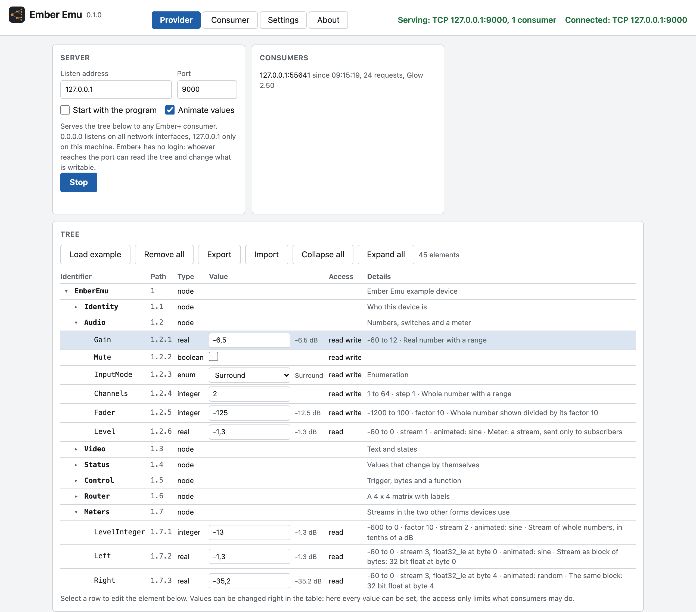
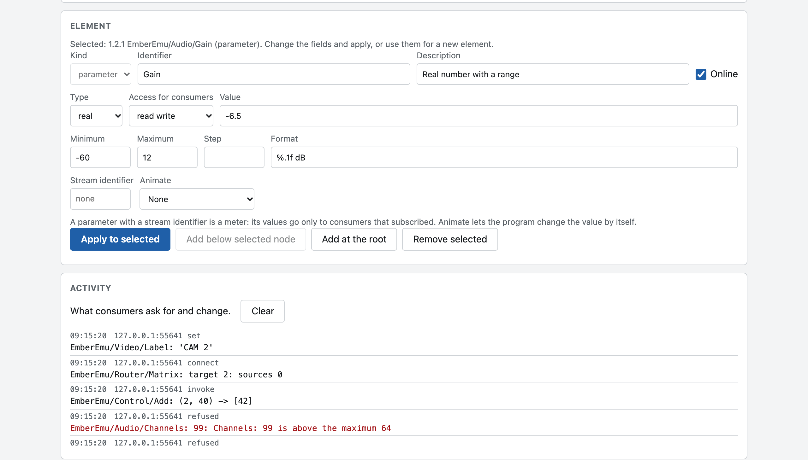
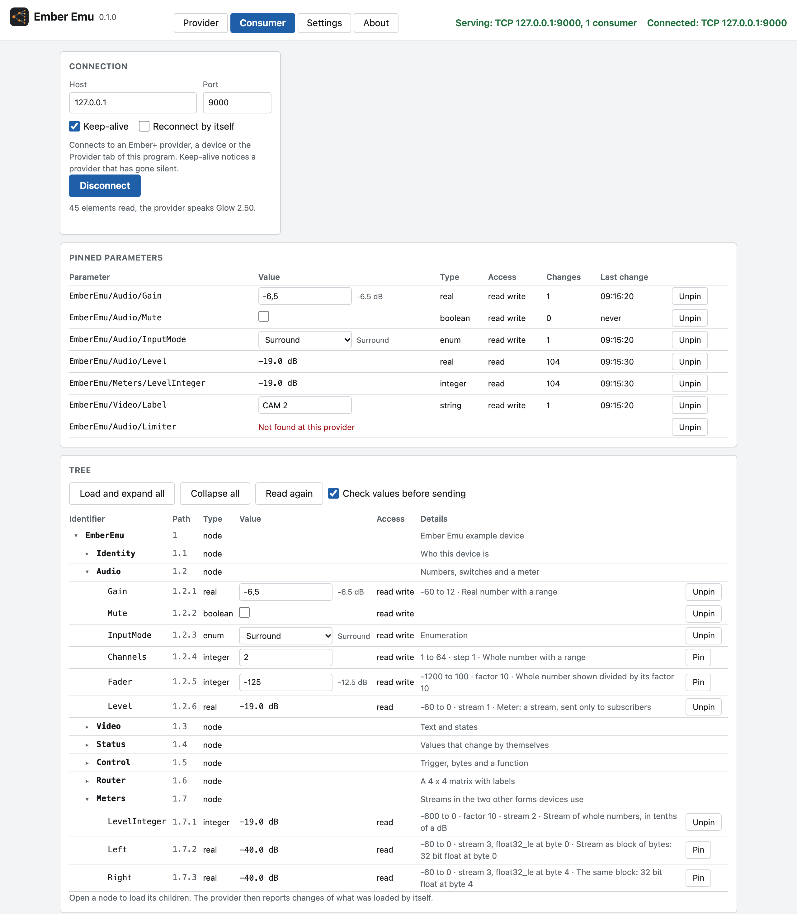
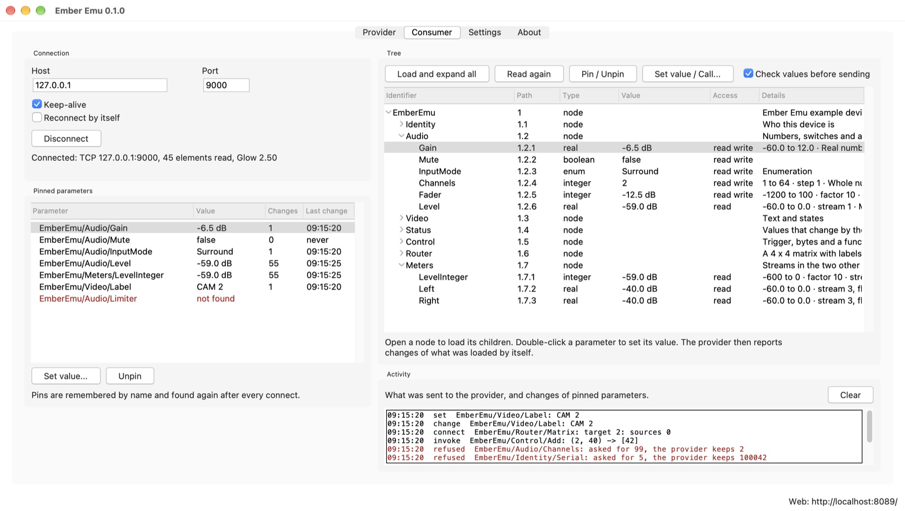
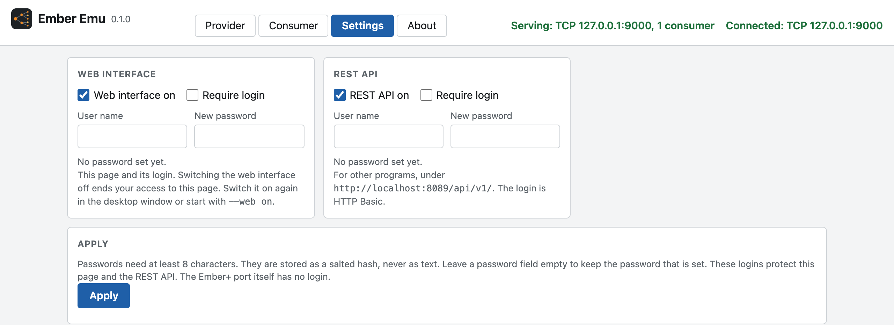

# Using Ember Emu

The desktop window and the web interface show the same four views and control
the same provider and consumer. What you change in one appears in the other.

- [Ember+ in a few sentences](#ember-in-a-few-sentences)
- [Starting](#starting)
- [Provider: the virtual tree](#provider-the-virtual-tree)
- [Consumer: reading a provider](#consumer-reading-a-provider)
- [Settings](#settings)
- [Typical tasks](#typical-tasks)
- [When something does not work](#when-something-does-not-work)
- [Where settings are stored](#where-settings-are-stored)
- [Words used here](#words-used-here)

## Ember+ in a few sentences

A device shows what it can do as a **tree**. **Nodes** are the folders,
**parameters** are the values: numbers, text, switches, enumerations. The
device that owns the tree is the **provider**. A program that reads and
controls it, such as a control system or a panel, is a **consumer**. The two
talk over one TCP connection, usually on port 9000.

Every element has a number that is unique among its siblings. The numbers from
the root down form its **path**, written `1.2.1`. It also has an
**identifier**, a name that never changes, so `EmberEmu/Audio/Gain` means the
same parameter. Ember Emu accepts both forms wherever a path is asked for.

Ember Emu is both sides in one program: a provider with a tree you put
together yourself, and a consumer that reads any provider.

## Starting

```bash
python -m emberemu_app
```

This opens the window and serves the web interface on <http://localhost:8089/>
and the REST API on <http://localhost:8089/api/v1/>. The packaged Mac app does
the same when opened.

| Option | Effect |
|---|---|
| `--serve` | Start serving the virtual tree on its Ember+ port right away |
| `--no-gui` | No window, for a machine without a screen |
| `--no-web` | No web server: neither web interface nor REST API |
| `--port 8089` | Port of the web server |
| `--host 0.0.0.0` | Make the web server reachable from other machines |
| `--tls-cert FILE --tls-key FILE` | Serve over HTTPS |
| `--config FILE` | Settings file to use |
| `--web on` / `--web off` | Switch the web interface on or off |
| `--api on` / `--api off` | Switch the REST API on or off |
| `--web-login USER` / `--no-web-login` | Require a login for the web interface, or not |
| `--api-login USER` / `--no-api-login` | Require a login for the REST API, or not |

`--port` and `--host` belong to the web server. The Ember+ port of the virtual
provider is set in the Provider view.

`--no-gui --no-web --serve` leaves nothing but the virtual provider: an Ember+
device without any front end, for a test rig.

The four access options are saved, like changes in the Settings view. A login
option asks for the password in the terminal. Without a terminal it reads the
password from `EMBER_EMU_WEB_PASSWORD` or `EMBER_EMU_API_PASSWORD`. Passwords
are never taken from the command line.

## Provider: the virtual tree



### Serving

| Control | Meaning |
|---|---|
| Listen address | Where consumers may connect. `0.0.0.0` listens on all network interfaces, `127.0.0.1` only on this machine |
| Port | The Ember+ port. Devices usually use 9000 |
| Start / Stop | Opens or closes the port. Closing ends all connections |
| Start with the program | Open the port at every start |
| Animate values | Let the parameters that have an animation change by themselves |
| Consumers | Who is connected: address, since when, number of requests, and the version of the Ember+ schema the consumer announced |

Changing address or port while serving stops the provider. Press **Start**
again.

Ember+ has no login. Whoever reaches the port can read the tree and change
every parameter that is writable.

### The tree

Every element has a row: identifier, path, type, value, access and details
(range, step, factor, stream, animation, description).

- **Values** are changed right in the table. Here every value can be set, also
  those that consumers can only read: the access limits consumers, not you.
  Every connected consumer that looked at the parameter is told at once.
- The small triangles open and close nodes. **Collapse all** and **Expand
  all** do it for the whole tree.
- A **matrix** has a **Connect** button: give a target and its sources.
- Click a row to select it. The **Element** box below then shows its
  properties.

| Button | Does |
|---|---|
| Load example | Replaces the tree with the example tree |
| Remove all | Empties the tree |
| Export | Saves the tree as a JSON file |
| Import | Replaces the tree with one from such a file |

The tree is saved when it changes and is there again at the next start.

### The example tree

A new installation starts with a tree that has one of everything:

| Node | Shows |
|---|---|
| `Identity` | Text and a number that consumers can only read, and a name they can change |
| `Audio` | A real number with range and format, a switch, an enumeration, whole numbers with range and with factor, and a meter |
| `Video` | Text, an enumeration with its own numbers, a state that is read only |
| `Status` | Values that change by themselves: clock, counter, random walk. And a node that is offline |
| `Control` | A trigger, bytes, and a function that adds two numbers |
| `Router` | A 4 x 4 matrix with label parameters for targets and sources |
| `Meters` | Meters in the two other forms devices use: whole numbers, and two values in one block of bytes |

### Elements



The **Element** box edits the selected element and makes new ones.

| Button | Does |
|---|---|
| Apply to selected | Writes the fields to the selected element. Consumers are told |
| Add below selected node | Makes a new element from the fields, as child of the selected node |
| Add at the root | Makes a new element from the fields, at the top of the tree |
| Remove selected | Removes the element and everything below it |

To make a new element, select the node it should live in, fill in the fields
and press **Add below selected node**. The quickest way to a similar element
is to select an existing one, change identifier and whatever differs, and add.

| Kind | Fields |
|---|---|
| node | Identifier, description, online |
| parameter | Identifier, description, type, access, value, online, and by type: minimum, maximum, step, format (numbers), factor (integer), enumeration (enum), stream identifier, animation |
| function | Identifier, description, arguments and result |
| matrix | Identifier, description, matrix type, number of targets and sources |

The number of an element is given by the program and stays for as long as the
element exists. Kind and number cannot be changed afterwards.

| Field | Meaning |
|---|---|
| Identifier | The name. Starts with a letter or an underscore, contains no slash, and is unique among its siblings |
| Description | Text for people. Consumers show it instead of the identifier |
| Online | Off marks a node or parameter as not available |
| Type | `integer`, `real`, `string`, `boolean`, `trigger`, `enum`, `octets` |
| Access for consumers | `read`, `write`, `read write` or `none` |
| Value | Read according to the type: `-6,5` or `-6.5`, `true` or `false`, the name or number of an enumeration entry, hex digits for octets (`01 FF`) |
| Minimum, Maximum | Range of a number. Values outside are refused, also from consumers |
| Step | A step that consumers may offer in their controls |
| Factor | A whole number is shown divided by this: value -125 with factor 10 is shown as -12.5 |
| Format | How to show a number, in C notation: `%.1f dB`, `%d ms` |
| Enumeration | One entry per line. The value is the position, starting at 0. `Name=5` gives an entry its own number |
| Stream identifier | Makes the parameter a meter, see below |
| Animate | Lets the program change the value by itself, see below |

A **trigger** has no value. Consumers fire it, and the activity list shows it.

Changing the type of a parameter starts its value again, because the old
value seldom fits the new type.

### Values that change by themselves

| Animation | For | Does |
|---|---|---|
| Clock | string | The time of day, `hh:mm:ss` |
| Counter | integer | One step up every second. After the maximum it starts again at the minimum |
| Sine | integer, real | Swings between minimum and maximum, once in 8 seconds |
| Random walk | integer, real | Wanders between minimum and maximum, two steps a second |

Without minimum and maximum, 0 and 100 are used. **Animate values** in the
Server box switches all animations off and on.

### Meters

A parameter with a **stream identifier** is a meter. Its values are not sent
like other changes: they go only to consumers that subscribed, bundled about
16 times a second.

Devices send meters in three forms, and not every consumer reads all three.
The example tree has one of each, to try a consumer against:

| Form | In the example tree | Read by |
|---|---|---|
| Whole numbers | `Meters/LevelInteger`, in tenths of a dB with factor 10 | every consumer |
| A block of bytes that holds several values | `Meters/Left` and `Meters/Right` | consumers that know stream descriptors |
| Real numbers | `Audio/Level` | valid, but some consumers ignore it |

A block of bytes is made through Import or the REST API: give the parameters
the same stream identifier and each a `stream_descriptor` with its format and
byte position, for example `["float32_le", 4]`.

### Functions and matrices

A **function** is described by its arguments and its result, written as type
and name, separated by commas: `integer a, integer b`. A function of the
virtual tree answers with the sum of the numbers it gets if the result is a
number, with its arguments joined if the result is text.

A **matrix** connects sources to targets. `one to n` gives each target one
source, `one to one` also gives each source one target, `n to n` allows
anything. Signals are numbered from 0. Labels as in the example tree are part
of the tree file and of the REST API.

### What consumers get refused

A consumer that sends a value which does not fit the type, lies outside
minimum and maximum, or goes to a parameter that is read only gets the current
value back, as Ember+ asks. The **Activity** list shows the request as
refused, with the reason. It also lists every connect, every request for a
part of the tree, every change and every function call.

### The tree as a file

Export writes the tree as JSON. Every element is an object, children are a
list inside their parent:

```json
{
  "children": [
    {
      "kind": "node",
      "number": 1,
      "identifier": "Device",
      "children": [
        {
          "kind": "parameter",
          "number": 1,
          "identifier": "Gain",
          "type": "real",
          "access": "read_write",
          "value": -12.0,
          "minimum": -60.0,
          "maximum": 12.0,
          "format": "%.1f dB"
        }
      ]
    }
  ]
}
```

All fields are listed in [rest-api.md](rest-api.md#fields-of-an-element). A
tree may hold 20,000 elements, nested 64 levels deep.

## Consumer: reading a provider



### Connecting

| Control | Meaning |
|---|---|
| Host, Port | The provider: a device, or `127.0.0.1` and the port of the Provider view |
| Keep-alive | Ask a provider that has been silent for 5 seconds for a sign of life. Without an answer for 15 seconds the connection counts as lost |
| Reconnect by itself | Try again every 3 seconds after the connection was lost |
| Connect / Disconnect | Opens or closes the connection |

After connecting, the root elements are read. The line below the button says
how many elements are known and which version of the Ember+ schema the
provider speaks.

### The tree

The tree is loaded piece by piece, because trees of real devices are large.

- Open a node with its triangle. Its children are read from the provider.
  From then on the provider reports changes below that node by itself.
- **Load and expand all** reads the whole tree, up to 5000 elements.
- **Read again** asks once more for the root and every open node, and drops
  what the provider no longer lists.
- **Collapse all** closes all nodes. Nothing is forgotten.

What can be done in a row depends on the element:

| Element | Control |
|---|---|
| Parameter that is writable | A field, switch or list for the value. The provider answers with the value it accepted |
| Parameter that is read only | The value as text |
| Trigger | A **Trigger** button |
| Function | **Call**: asks for the arguments, separated by commas, and shows the result |
| Matrix | **Connect**: asks for a target and its sources |
| Any parameter | **Pin** |

### Sending values that should be refused

**Check values before sending** is on by default: parameters that are read
only cannot be edited, and a value outside the range the provider announced is
refused before it is sent.

Switch it off to test a provider. Then every parameter gets a field, and
whatever you type is sent as it is. A provider that works correctly answers
with the value it kept. The activity list shows what you asked for and what
the provider reports.

### Pinned parameters

A pin keeps a parameter in view. The table at the top shows every pinned
parameter with its latest value, how often it changed since the connect, and
when it changed last. Writable ones can be changed right there.

- Pins are remembered by identifier path, such as `EmberEmu/Audio/Gain`,
  because the numbers of a tree may differ from one session to the next.
- After every connect the pins are looked up again. A pin whose parameter the
  provider does not have is shown as not found. It stays, so it is there when
  you connect to the right device again.
- Pinning a meter subscribes to its stream. Without a pin the value of a meter
  stands still.
- Up to 200 parameters can be pinned.

The **Activity** list shows what was sent to the provider, what it refused,
and every change of a pinned parameter. Meters are left out, they would flood
the list.

### The desktop window



The window has the same parts. Values are changed with a double click on the
row, or with **Set value / Call**. **Pin / Unpin** works on the selected row.

## Settings



The Settings view has two doors:

| Door | Switch | Login |
|---|---|---|
| Web interface | on or off | optional: user name and password, with a login page |
| REST API | on or off | optional: user name and password, as HTTP Basic |

The two logins are independent. With both doors off the port is closed.
Passwords need at least 8 characters and are stored only as a salted scrypt
hash.

These logins protect the web interface and the REST API. The Ember+ port of
the virtual provider has no login, because the protocol knows none.

If the web interface is switched off from the web interface, that page stops
working. Switch it on again in the window or start with `--web on`.

Changing the web login from the web interface needs the current password.
Without a web login, only the machine Ember Emu runs on can change the access
settings.

When the web server is reachable from the network, the Settings view warns
about doors without login and about logins without HTTPS.

## Typical tasks

### Try it without any hardware

1. In **Provider** set the listen address to `127.0.0.1` and press **Start**.
2. In **Consumer** press **Connect** (127.0.0.1, port 9000).
3. Open `EmberEmu` and `Audio`, and pin `Gain` and `Level`.
4. Change `Gain` on either side. The other side follows. `Level` moves by
   itself.

### Test a control system against a device that is not there

1. Build the tree of the device in **Provider**, or import it from a file.
2. Leave the listen address at `0.0.0.0` and press **Start**.
3. Point the control system at the address of this machine, port 9000.
4. Watch the **Activity** list: it shows what the control system reads, what
   it sets, and what was refused and why.
5. Change values in the tree and see whether the control system follows.

### Take the tree of a real device home

The library that comes with Ember Emu has a script for it:

```bash
python examples/tree_to_json.py save 192.168.1.50 device.json
```

Import `device.json` in **Provider**. The copy has the structure, values and
access rights of the device. See
[ember-emu-lib](https://github.com/MarcusMa-dotcom/ember-emu-lib).

Ember Emu serves only trees that keep to the rules of Ember+. If the device
does not, for example with an identifier that starts with a digit or a value
outside its own range, the import names the element and what is wrong with
it. Correct that in the file and import again.

### Watch a few values of a large device

1. Connect in **Consumer**.
2. Open the nodes down to the parameters you care about and pin them. Or pin
   them by name through the REST API, without opening anything.
3. Collapse the tree. The pin table keeps showing the values and counts the
   changes.

The pins are still there after a restart and are found again by name.

### See how a device reacts to wrong values

1. Connect in **Consumer** and switch **Check values before sending** off.
2. Type a value outside the range, or into a parameter that is read only.
3. The activity list shows what the device answered. It should report the
   value it kept.

### Run only the virtual device, on a machine without screen

```bash
python -m emberemu_app --no-gui --no-web --serve
```

The tree is the one saved last. To change it from elsewhere, leave the web
server on and use the [REST API](rest-api.md).

## When something does not work

| What you see | Reason and remedy |
|---|---|
| "Cannot listen on ...: Address already in use" | Another program uses the Ember+ port, often a second Ember Emu or another provider. Choose another port |
| A consumer on another machine cannot connect | The listen address is `127.0.0.1`. Set it to `0.0.0.0`. Check the firewall of this machine |
| macOS asks whether Ember Emu may find devices on the local network | Allow it. Without it, connections to other machines fail |
| "Cannot connect to ...: Connection refused" | Nothing listens there: wrong address or port, or the provider is not started |
| Connected, but the provider did not answer the request for its root elements | The other side accepts connections but does not speak Ember+, or needs longer. Press **Read again** |
| The value of a meter does not move in the consumer tree | Meters send only to subscribers. Pin the parameter |
| Another consumer shows no meter values | It may not read real numbers as stream. Try `Meters/LevelInteger`, see [Meters](#meters) |
| A pin says "Not found at this provider" | The provider has no parameter under that name. Connect to the right device, or unpin |
| "... is above the maximum" when setting a value | The check before sending refused it. Switch the check off to send it anyway |
| The connection drops after about 15 seconds of silence | The provider does not answer keep-alive requests. Switch **Keep-alive** off |
| The web page says "Ember Emu is not reachable" | The program was closed, or the web interface was switched off |
| The web interface works, but not from another machine | By default the web server answers on this machine only. Start with `--host 0.0.0.0`, and set logins |
| No window on Linux | Tk is missing. Install `python3-tk`, or use the web interface |
| The first start of the Mac app takes long | macOS looks through a new app once. Later starts take about two seconds |

## Where settings are stored

| System | Folder |
|---|---|
| macOS | `~/Library/Application Support/ember-emu/` |
| Windows | `%APPDATA%\ember-emu\` |
| Linux | `~/.config/ember-emu/` |

| File | Content |
|---|---|
| `settings.json` | Provider: listen address, port, switches |
| `settings.tree.json` | The virtual tree |
| `settings.consumer.json` | Consumer: host, port, switches and pins |
| `settings.access.json` | Switches, user names and password hashes. Readable by the owner only |

Settings are saved when they change and loaded at the next start. Delete the
folder to start from the defaults and the example tree.

## Words used here

| Word | Meaning |
|---|---|
| Provider | The side that owns a tree: a device, or the Provider view |
| Consumer | The side that reads and controls a tree: a control system, or the Consumer view |
| Node | A folder in the tree |
| Parameter | A value in the tree |
| Path | The numbers from the root down to an element: `1.2.1` |
| Identifier | The name of an element. It never changes |
| Identifier path | The identifiers from the root down: `EmberEmu/Audio/Gain` |
| Access | What consumers may do with a parameter |
| Stream | A value that is sent only to subscribers, such as a meter |
| Trigger | A parameter without value that is fired |
| Function | Something a consumer can call, with arguments and a result |
| Matrix | A table of which sources are connected to which targets |
| Pin | A parameter the consumer keeps in view |
| S101, Glow | The framing and the data schema of Ember+, see the [library](https://github.com/MarcusMa-dotcom/ember-emu-lib/blob/main/docs/protocol.md) |
